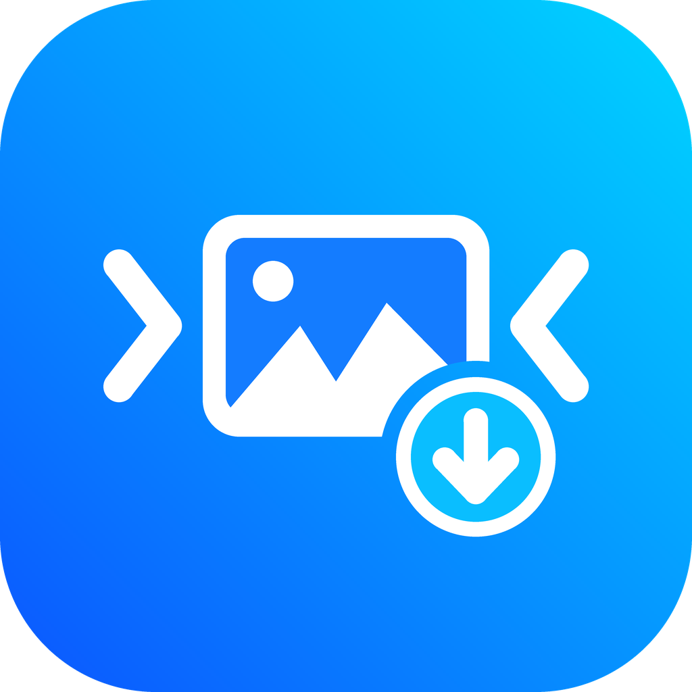
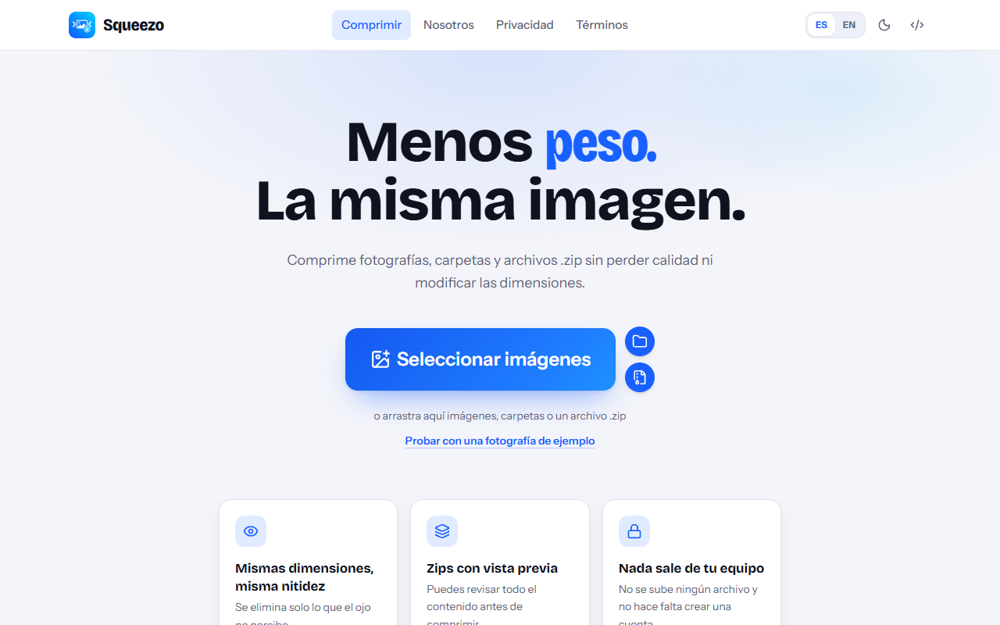
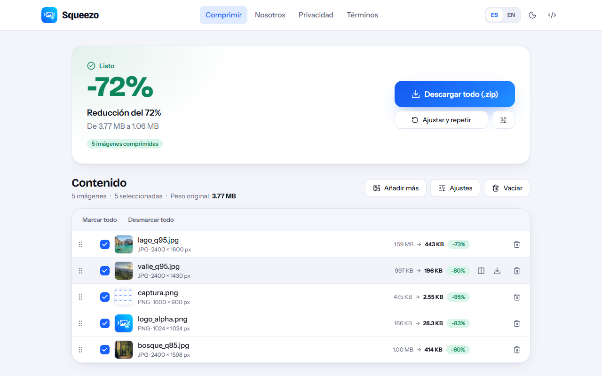
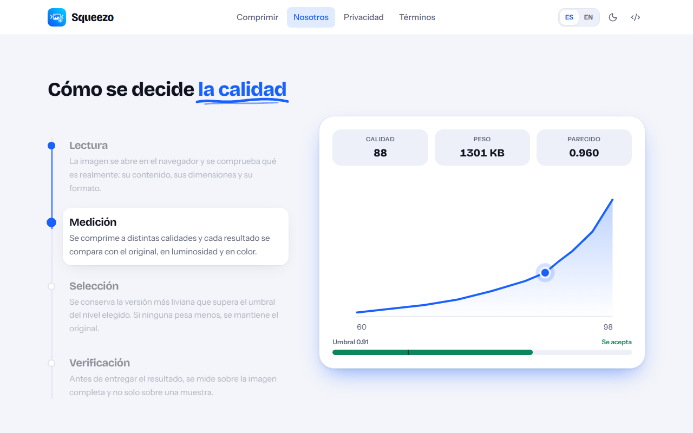

<p align="center">
  
</p>

<h1 align="center">Squeezo</h1>

<p align="center">
  <b>An image compressor that cuts the weight of your images without losing quality or dimensions.</b> Drop in
  single photos, folders or a whole .zip, check what is inside and download everything lighter.
  <i>It all happens in your browser: your images are never uploaded to any server.</i>
</p>

<p align="center">
  <a href="README.md">Español</a> · <a href="README.en.md">English</a>
</p>

<p align="center">
  <a href="https://github.com/Cris223511/image-compressor/actions/workflows/ci.yml"></a>
  <a href="https://github.com/Cris223511/image-compressor/releases/latest"></a>
  
  
  
  <a href="LICENSE"></a>
</p>

---

## Live demo

Squeezo runs **right in the browser**, with nothing to install and no account to create.

**[squeezo-six.vercel.app](https://squeezo-six.vercel.app)**

Open it, drop in your images, folders or a .zip and download the result. The changes of each version are in the [changelog](CHANGELOG.md).

<p align="center">
  
  
</p>

## How it works

Drag your images in, Squeezo compresses them and you download the result. There is nothing to set up by default: the file gets smaller and looks the same, with the same width, the same height and the same sharpness. If you would rather decide yourself, there are optional settings.

It is meant for anyone with a heavy folder of photos, screenshots or designs who needs to send it, upload it to a website or free up space without anything showing.

## Features

- **Much less weight without it showing.** By default it looks for the smallest weight whose difference cannot be seen at a glance, with the same dimensions. There are three levels: recommended, high quality and maximum compression. If an image cannot be reduced any further, it is left as it is and you are told.
- **The usual image formats.** JPG, PNG, WebP, AVIF, GIF (animated too), SVG and BMP. TIFF and HEIC are processed in browsers that can read them.
- **.zip files and folders.** Up to 1000 images per zip, with folders and subfolders. Before compressing, the contents are shown as a tree with thumbnails and the size of each file, so you pick what goes in.
- **Flags what is not an image.** Videos and other files inside the zip are skipped, and you are told how many and what kind.
- **Optional settings.** Compression level, conversion to WebP, AVIF, JPG or PNG, keeping metadata and limiting the size. Everything is off by default.
- **A list that fits you.** Every image or folder can be removed with a confirmation, and images are reordered by dragging the dotted handle. The order you choose is the one used when compressing and downloading.
- **Before and after comparison** to check the result image by image.
- **Flexible download.** One by one, or everything together in a .zip with the same folder structure.
- **Your progress is not lost.** If you allow it in the cookie preferences, when you reload, go back or close the tab you pick up where you left off, even in the middle of a compression. Everything stays in your browser.
- **You decide what is saved.** An initial notice and a cookie page let you turn on or withdraw, separately, the memory of the settings, of the working session and of the global counter of compressed images.
- **Spanish and English,** with light and dark themes.

## Security and privacy

> **Your images are processed entirely on your computer.** Nothing is uploaded to any server. There are no accounts, no tracking and no analytics. The only thing that may be sent, and only if you allow it in the cookie preferences, is the number of images reduced when a compression finishes, for the global counter on the About page.

Since the site accepts any file, these measures are in place:

- The real content of each file (its binary signature) is checked, not just the extension. Only images get in.
- Nothing you upload is ever executed. Files that are not images are discarded.
- Zips are checked against malicious paths, suspicious compression ratios and nested or encrypted archives.
- SVG files are stripped of scripts before they are processed.
- The pixel size of each image is capped so none can exhaust memory.
- Security headers and a strict content policy, with no third-party scripts.

## Technologies

| Component | Tool | What it is used for |
| --------- | ---- | ------------------- |
| Interface | [React 18](https://react.dev/) and [TypeScript 5](https://www.typescriptlang.org/) | The app, with strict typing |
| Bundling | [Vite 5](https://vite.dev/) | Dev server and production build |
| Styles | [Tailwind CSS](https://tailwindcss.com/) | The design and the light or dark theme |
| Compression | [jSquash](https://github.com/jamsinclair/jSquash) (MozJPEG, OxiPNG, WebP, AVIF), [SVGO](https://svgo.dev/) and [Gifsicle](https://www.lcdf.org/gifsicle/) | The codecs, compiled to WebAssembly |
| Parallelism | Web Workers | Compress several images at once without freezing the page |
| Zip files | [fflate](https://github.com/101arrowz/fflate) | Read and create zips without loading them fully into memory |
| Deployment | [Vercel](https://vercel.com/) | Static site with one function for the global counter (Upstash Redis) |

## Run locally

You need **Node.js 18** or later.

```
npm install
npm run dev
```

## Commands

| Command | What it does |
| ------- | ------------ |
| `npm run dev` | Dev server with hot reload. |
| `npm run build` | Type-checks and builds the production version into `dist`. |
| `npm run preview` | Serves the build output locally. |
| `npm test` | Runs the automated tests. |

## How quality is decided

Each JPG, WebP or AVIF is encoded several times and compared with the original by measuring block-wise similarity (SSIM over luminance and color). Squeezo keeps the lightest version that passes the threshold of the chosen level, and the final result is verified on the full image. PNG files with many colors are reduced to a palette when it does not show, except in high quality, which loses not a single pixel. If nothing improves the weight, the original file is kept.

<p align="center">
  
</p>

## Contributing

Bug reports and ideas are welcome in the [issues](https://github.com/Cris223511/image-compressor/issues). To contribute code, open a pull request.

## License

**MIT** © [Cris223511](https://github.com/Cris223511). You are free to use, modify and share it. The full text is in the [LICENSE](LICENSE) file.
